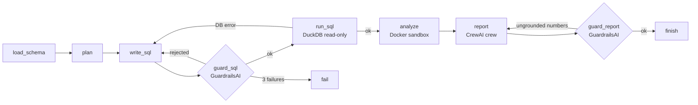

# Tahlil — Autonomous Data Analyst Agent

[](https://github.com/Ahmad-dev-top/tahlil/actions/workflows/ci.yml)
[](https://github.com/Ahmad-dev-top/tahlil/actions/workflows/evals.yml)

Upload a CSV, ask a question in plain English, get back **SQL, a result table, a chart and a short report**. Every query is checked before it runs, every line of analysis code runs in a locked-down Docker container, and every number in the report is checked against the actual results.

**Stack:** LangGraph · CrewAI · GuardrailsAI · Docker · DuckDB · FastAPI · Next.js + React + Tailwind · litellm (any model)

> Build status and the full roadmap are in **[PLAN.md](PLAN.md)**.

## How it works



| Layer | Role |
|---|---|
| **LangGraph** | State machine: retries, validator feedback loops, failure routing, full step trace |
| **GuardrailsAI** | `ReadOnlySQL`: one SELECT, known tables only, no file/system functions. `GroundedNumbers`: every figure in the report must exist in the results |
| **Docker** | Agent-written Python runs with no network, read-only filesystem, no capabilities, non-root, memory/CPU/PID limits and a timeout |
| **CrewAI** | Insight Analyst + Report Writer crew turns results into a decision-ready report |
| **DuckDB** | Each dataset is its own DB file, always opened read-only for queries |

### Safety in depth
1. **SQL guard** blocks DDL/DML, multi-statements, `read_csv`/`glob`/`getenv` and other file/system functions, and unknown tables. The reason is fed back to the model so it can correct itself.
2. **Read-only DB connection.** Even if a query got past the guard, it couldn't change data.
3. **Sandboxed code.** The analysis step only ever sees a CSV copy of the query result.
4. **Grounding check.** Tolerance follows the precision the writer used: `45.15M` may stand for 45,151,248, but `42%` may not stand for 38.2%. If the report still fails after retries, the response returns `verified: false` with the reason. It is never silently passed off as checked.

## Quick start

```bash
cp .env.example .env          # add your model API key
docker compose up --build     # web UI on http://localhost, API on 127.0.0.1:8000
```

**No API key?** Set `LLM_MODE=fake` in `.env` for an offline demo of the full pipeline.

**Local dev without Docker:**
```bash
pip install -r requirements.txt
LLM_MODE=fake SANDBOX_MODE=local uvicorn app.api:app --reload
```
`SANDBOX_MODE=local` runs analysis code as a plain subprocess. It is **not isolated**, so use it only for development.

## API

| Route | |
|---|---|
| `GET /datasets` · `POST /datasets` | List / upload CSVs (each file becomes a table) |
| `POST /datasets/connect` · `POST /datasets/{id}/refresh` | Snapshot a Postgres/MySQL database |
| `GET /datasets/{id}` | Dataset + schema |
| `POST /conversations` · `GET /conversations[/{id}]` | Chats with follow-up questions |
| `POST /ask` | Ask a question, get the full result |
| `POST /ask/stream` | Same, as Server-Sent Events: one `step` per agent node, then `result` |

```bash
curl -F "files=@sample_data/sales.csv" localhost:8000/datasets
curl localhost:8000/ask -H 'content-type: application/json' \
  -d '{"dataset_id":"<id>","question":"Which region and channel drive the most revenue?"}'
```

The result includes `plan`, `sql`, `rows`, `stats`, `charts`, `report`, `verified`, `unverified_reason` and `trace` (every step, including rejected attempts and why). If `API_KEYS` is set, send `X-API-Key`. Interactive docs are at `/docs`.

## Web UI

`frontend/` is a Next.js 16 + React 19 + Tailwind 4 app with a sidebar for datasets and chats. Answers show live agent steps, a "Numbers verified" badge, the report, the chart, and data/SQL/plan panels. It builds to static files served by nginx.

```bash
cd frontend && npm install && npm run dev     # http://localhost:3000, talks to the API on :8000
npm test && npm run build                     # unit tests + static build
npm run test:e2e                              # browser test (needs the API running)
```

## Evals

`evals/questions.json` has 23 questions: 20 with reference SQL, and 3 the data cannot answer (no cost column, no customer id, and only 2025 in the file). A numeric question passes when the agent's rows contain every reference number (±0.5%, or ×100 when a share is shown as a percent) and every reference text value. An unanswerable question passes when the run finishes, the report is verified, and the report says the data cannot answer it.

```bash
python -m evals.run --label A --model anthropic/claude-sonnet-5-5
python -m evals.run --label B --model anthropic/claude-haiku-5-5
python -m evals.run --label C --model anthropic/claude-haiku-5-5 --no-crewai
python -m evals.run --fake     # harness self-test, no API key
python -m evals.run --questions evals/holdout.json --model anthropic/claude-haiku-5-5
```

Each result file records, per question, pass/fail, the reason, verified, SQL and report attempts, seconds, tokens, cost, and per-step `duration_ms`. The summary adds accuracy, verified rate, first-try report rate (`report_attempts == 1`), average / p50 / p90 seconds, and average and total cost.

The 100% numbers in this table are the **tuning set** (`evals/questions.json`), the 23 questions the prompts were adjusted on.

| Config | Accuracy | Verified | First-try report | p50 | p90 | Avg cost / question |
|---|---|---|---|---|---|---|
| Sonnet 5.5 + CrewAI | 100% | 100% | 96% | 32.3s | 46.0s | $0.034 |
| Haiku 5.5 + CrewAI | 100% | 100% | 100% | 31.1s | 36.6s | $0.0020 |
| Haiku 5.5, no CrewAI | 100% | 100% | 91% | 25.7s | 35.3s | $0.0028 |

Median time in each step (ms). `analyze` is the Docker sandbox. `report` is CrewAI, or one model call when CrewAI is off.

| Step | Sonnet + CrewAI | Haiku + CrewAI | Haiku, no CrewAI |
|---|---:|---:|---:|
| load_schema | 101 | 100 | 103 |
| plan | 4,266 | 3,524 | 3,506 |
| write_sql | 2,995 | 2,776 | 3,334 |
| guard_sql | 12 | 11 | 13 |
| run_sql | 48 | 42 | 47 |
| analyze | 13,532 | 11,547 | 11,033 |
| report | 11,547 | 11,721 | 5,432 |
| guard_report | 10 | 9 | 17 |

The Docker sandbox is inside `analyze`, and its security flags were left unchanged. CrewAI adds a second report call, so that step takes about 12 seconds instead of 5.

**Held-out set** (`evals/holdout.json`, 10 new questions, prompts not changed after the run): Haiku 5.5 + CrewAI scored **90% accuracy and 90% verified**. The miss was “Which city brought in the most sales?”: there is no city column, and the model ranked regions instead of saying so.

**Stability** on the tuning set, Haiku 5.5 + CrewAI, three separate runs:

| Run | Accuracy | Verified | First-try report |
|---|---|---|---|
| 1 | 100% (23/23) | 100% | 96% (22/23) |
| 2 | 100% (23/23) | 100% | 91% (21/23) |
| 3 | 100% (23/23) | 100% | 91% (21/23) |

Mean accuracy 100% (range 0), mean verified rate 100% (range 0), mean first-try report rate 93% (range 91–96%).

Recommended default: `anthropic/claude-haiku-5-5` with CrewAI on. That is what `.env.example` sets. On the tuning set it matched Sonnet on accuracy and verification at about $0.002 per question instead of $0.034. The held-out run is the number that was not tuned for: 90%.

## Tests

```bash
pytest -q        # 57 tests, no API key or Docker needed; 2 more run when TAHLIL_LIVE_DB=1
```
They cover guards, self-correction, report grounding, streaming, conversations, DB connectors, auth, rate limits and the eval scorer.

## Configuration (`.env`)

| Variable | Default | |
|---|---|---|
| `LLM_MODEL` | `anthropic/claude-haiku-5-5` | Any litellm model string |
| `LLM_TEMPERATURE` | empty | Empty omits temperature. A number is sent as-is |
| `LLM_MODE` | `live` | `fake` = offline demo |
| `USE_CREWAI` | `true` | `false` = single LLM call for the report |
| `SANDBOX_MODE` | `docker` | `local` = dev only |
| `SANDBOX_TIMEOUT_S` / `SANDBOX_MEMORY` | `30` / `512m` | Per-run limits |
| `MAX_SQL_ATTEMPTS` / `MAX_REPORT_ATTEMPTS` | `3` / `2` | Retry budgets |

## Project layout

```
app/
  graph.py       LangGraph agent (nodes, routing, streaming)
  guards.py      GuardrailsAI validators
  crew.py        CrewAI report crew
  sandbox.py     Docker / local code runner
  db.py          DuckDB datasets (read-only queries)
  connectors.py  Postgres/MySQL snapshot import
  store.py       SQLite: datasets, conversations, turns
  llm.py         litellm client + scripted FakeLLM
  api.py         FastAPI: auth, rate limit, SSE
sandbox/         Sandbox image + in-container runner
frontend/        Next.js + React + Tailwind UI (+ nginx proxy image)
evals/           Questions with known answers + scorer
sample_data/     2,400-row sales dataset (PKR, Pakistani regions/channels)
tests/
```
