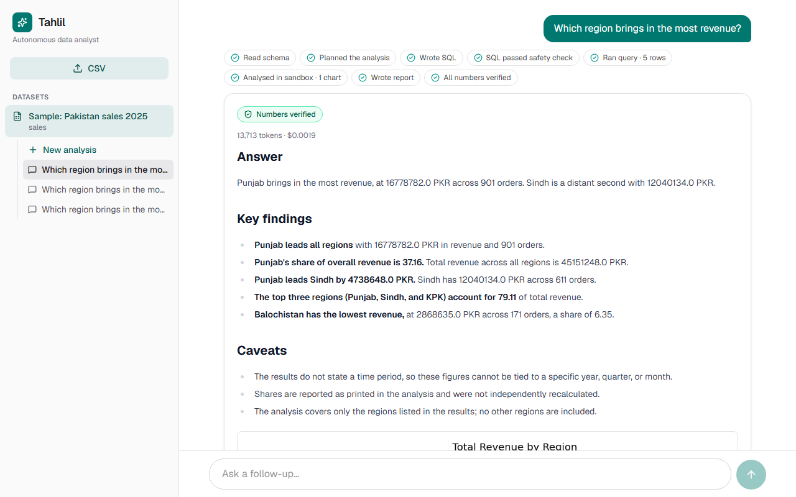
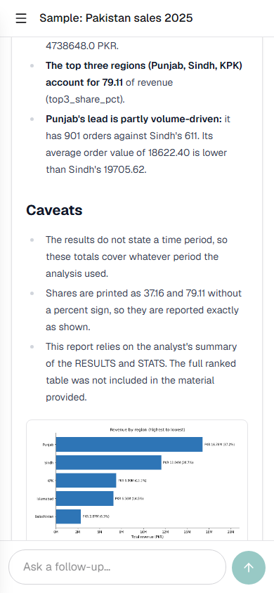
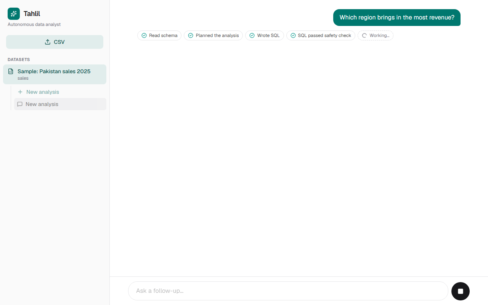

# Tahlil: a data analyst that shows its work

Upload a CSV, ask in plain English, and get SQL, a chart, and a short report. The report is only useful if the SQL is safe to run and the numbers in the prose are the numbers the query returned. Tahlil is that agent. The live demo is [tahlil.muhammad-dgr.duckdns.org](https://tahlil.muhammad-dgr.duckdns.org), loaded with a 2,400-row sample of Pakistan sales for 2025.

## Architecture

The UI is a static Next.js export. nginx proxies `/api` to FastAPI and keeps the API key on the server. FastAPI stores datasets, conversations, and turns in SQLite and runs one LangGraph graph per question:

`load_schema → plan → write_sql → guard_sql → run_sql → analyze → report → guard_report → finish`

A failed SQL check or a database error returns the reason to `write_sql` (three attempts). A failed number check returns the reason to `report` (two attempts). Each node is stored with `duration_ms`, and `/ask/stream` sends those steps while the question is still running.

## Three safety layers

1. **SQL guard.** `ReadOnlySQL` allows one SELECT against tables that exist in the schema. It blocks DDL, DML, multi-statements, and file or system functions such as `read_csv`, `glob`, and `getenv`. The reason goes back to the model.
2. **Read-only database.** The query connection is opened read-only, so a statement that got past the guard cannot change the file.
3. **Sandboxed code.** Chart code sees a CSV copy of the result. The container is started with `--network none`, a read-only filesystem, `--cap-drop ALL`, `no-new-privileges`, a non-root user, and memory, CPU, PID, and time limits. The demo VM sets the sandbox to 256 MB. A chart question still returned a chart.

`GroundedNumbers` then checks the prose: each cited figure has to appear in the results, and the tolerance follows the precision the writer used (`45.15M` may stand for 45,151,248; `42%` may not stand for 38.2%). A report that still fails after the retry is returned with `verified: false` and the reason.

## Evaluation

Prompts were adjusted on 23 questions (`evals/questions.json`): 20 with reference SQL, and 3 the file cannot answer (no cost column, no customer id, and only 2025 in the data). A numeric question passes when the rows contain every reference number and every reference text value. An unanswerable question passes when the run finishes, the report is verified, and the report says the data cannot answer it. The scorer was left alone.

On that tuning set, Claude Haiku 5.5 with CrewAI scored 100% accuracy, 100% verified, and 100% first-try reports, with p50 31.1s, p90 36.6s, and an average of $0.0020 per question. Sonnet 5.5 with CrewAI matched the accuracy and verified rate at about $0.034 per question (p50 32.3s, p90 46.0s, first-try 96%). Haiku without CrewAI stayed at 100% accuracy and verified, with first-try 91%, p50 25.7s, and an average of $0.0028.

Ten new questions (`evals/holdout.json`) were scored after the prompts were frozen. Haiku 5.5 with CrewAI scored 90% accuracy and 90% verified. The miss was “Which city brought in the most sales?”: there is no city column, and the model ranked regions.

Three further runs of the tuning set, same model and crew, all scored 100% accuracy and 100% verified. First-try reports were 96% (22/23), 91% (21/23), and 91% (21/23). The mean first-try rate was 93%, with a range of 91–96%.

## Cost and latency

On the eval machine the operating point is Haiku 5.5 with CrewAI: about $0.002 per question, against $0.034 for Sonnet on the same tuning set. Median step times on that Haiku run were plan 3.5s, write SQL 2.8s, analyze 11.5s, and report 11.7s. A later five-question split put the sandbox at 2.4s inside `analyze` and the chart-code model call at 8.7s. Inside the report, the analyst took 5.5s and the writer 5.7s. The p50 of 31.1s is this machine, with CrewAI on.

The public demo is separate. It is a 1 GB VM, sandbox 256 MB, API container 450 MB, one uvicorn worker, CrewAI off. With CrewAI on, that API container peaked at 447 MiB and “What is the total revenue?” took 74.7s. With CrewAI off the same three questions took 41.6s, 34.7s, and 16.9s. All three were verified on the first report. After the first question the API sat near 180 MiB. The host was still using about 1.6–1.9 GB of swap.

## What went wrong, and the fix

Claude Sonnet 5.5 rejects a temperature other than 1. `LLM_TEMPERATURE` is empty by default, and the client omits the parameter so each model keeps its own default.

The SQL and chart-code writers sometimes wrapped the answer in a markdown fence. One monthly-trend query came back with only a trailing fence. `strip_fences` unwraps a matched pair and also strips a lone opening line or a lone closing fence. Backticks that belong to the query stay.

The report writer cited figures that were not in the result, including the year 2025 when that year was not in the result rows. `GroundedNumbers` fails the report, the graph retries with the failure in the prompt, and a second failure is returned as `verified: false`. The badge is withheld.

Two speedups are written down and not built: skip the chart and the container on a single-row result (about 11s on those questions), and merge `plan` and `write_sql` into one model call (about 3s at the median). The sandbox flags stay as they are.

